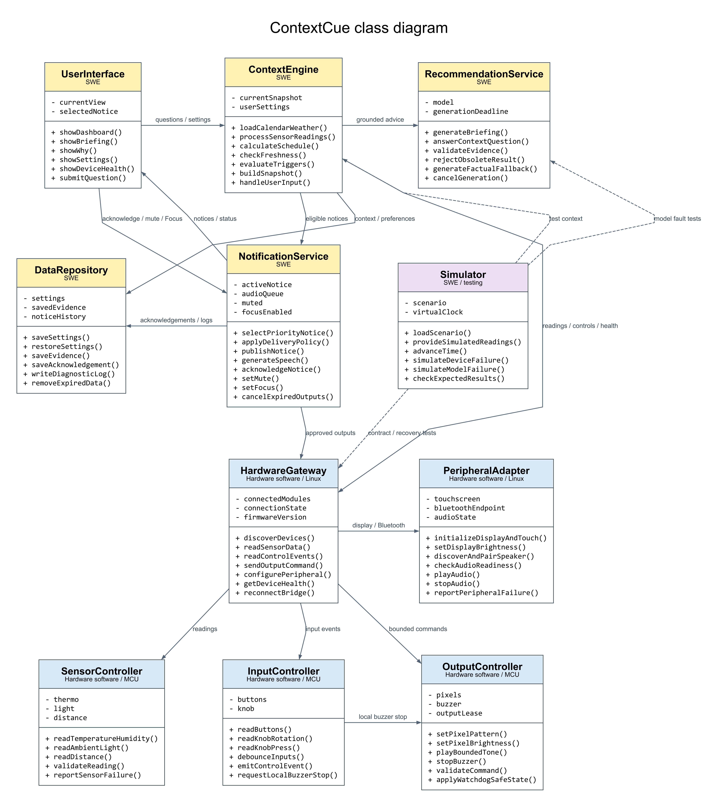

# ContextCue

ContextCue is an explainable desk companion designed to combine calendar and
weather context with real indoor sensing. It is intended to give a user useful,
timely desk cues through a screen, visual indicators, optional short buzzer
tones, and local Bluetooth speech.

The larger product is planned for an Arduino UNO Q. Its Linux side will run the
application, policy, model worker, persistence, user interface, and hardware
gateway. Its microcontroller side will read the Modulino devices and enforce
safe hardware limits.

> **Current status:** this repository contains the first hardware milestone,
> not the complete ContextCue product. The implemented path includes real
> Modulino Thermo and MCU-side Light acquisition; the Arduino Bridge, Python
> gateway, and JSON console still expose the Thermo-only protocol. The remaining
> application and hardware modules are planned or partially implemented.

## What ContextCue is meant to do

ContextCue will:

- Show the current time, schedule, indoor readings, forecast state, audio state,
  operating mode, and at most one highest-priority notice.
- Generate short, evidence-grounded morning, preparation, comfort, and
  context-question responses.
- Explain why a recommendation was made by showing its source values, units,
  timestamps, freshness, and real/simulated labels.
- Use deterministic software rules for freshness, eligibility, priority,
  acknowledgement, Focus, mute, quiet hours, deduplication, and expiration.
- Keep user controls and sensor handling responsive while model generation or
  audio playback is running.
- Continue unaffected functions when an individual sensor, Bridge, model,
  source, display, or audio component fails.
- Apply conservative availability-aware audio rules: near-desk reminders may
  use one chime or spoken notice when enabled; away-mode audio is opt-in and
  announces at most once; disconnected audio queues reminders silently; Focus
  and Do Not Disturb collect ordinary reminders for later.
- Use labeled local calendar and weather fixtures first; live providers are
  supported through adapters when configured.

Actual LLM generation and local Bluetooth speech are part of the target
product. A factual fallback is required when generation fails, but it does not
replace generation for final acceptance. The system must not invent source
facts or silently use a cloud fallback.

## Planned hardware

The selected panel contains five Modulino modules plus the UNO Q touchscreen:

| Module | Type | Intended responsibility |
|---|---|---|
| Thermo | Sensor | Temperature and relative humidity for indoor comfort |
| Light | Sensor | Ambient light level for screen and Pixel brightness |
| Distance | Sensor | Time-of-flight distance for near-object wake |
| Touchscreen | Linux input | Volume control, navigation, acknowledgement, and the active notice’s “Why” view |
| Pixels | Output | Fixed ready, notice, fault, and off patterns |
| Buzzer | Output | Optional, short, bounded attention tones |

The sensors report measurements only. They do not identify people or infer
occupancy, sleep, attention, identity, or emotional state.

The planned sensor targets are:

| Sensor | Unit | Target rate | Stale after |
|---|---|---:|---:|
| Thermo temperature | `degC` | 1 Hz | 5 seconds |
| Thermo humidity | `%RH` | 1 Hz | 5 seconds |
| Light | Verified lux or normalized level | 5 Hz | 2 seconds |
| Distance | `mm` | 10 Hz | 2 seconds |

The initial proximity policy is near at `<=500 mm`, clear at `>650 mm`, with
500 ms of valid persistence. Out-of-range distance is unknown, not “far away.”

## Architecture

The planned system is divided into product software and hardware software:

```text
UserInterface
      |
ContextEngine <-> RecommendationService
      |                    |
      v                    v
NotificationService <-> DataRepository
      |
      v
HardwareGateway <-> PeripheralAdapter
      |
      v
Arduino Bridge
      |
      v
MCU firmware
  SensorController
  OutputController
```



The editable architecture source is
[`designDiagram.mmd`](designDiagram.mmd). The detailed responsibilities are
documented in
[`background_Files/ContextCue_UML_Class_Reference.md`](background_Files/ContextCue_UML_Class_Reference.md).

### Main planned components

- **UserInterface** — Shows the dashboard, briefing, evidence explanation,
  settings, health, and simulation views.
- **ContextEngine** — Combines fixtures, sensor readings, settings, schedule
  calculations, freshness, and trigger rules into immutable context snapshots.
- **RecommendationService** — Runs bounded asynchronous model generation,
  validates evidence references, rejects obsolete results, and creates labeled
  factual fallbacks.
- **NotificationService** — Selects the highest-priority notice and applies
  mute, Focus, quiet-hours, expiration, acknowledgement, and output policy.
- **DataRepository** — Persists settings, evidence, acknowledgements,
  diagnostics, and retention-managed history.
- **Simulator** — Supplies labeled fixtures, virtual time, and controlled
  device/model failures using the same contracts as production.
- **HardwareGateway** — Owns discovery, sensor data, bounded commands, health,
  and safe Bridge recovery.
- **PeripheralAdapter** — Integrates the Linux display, touch input, and
  Bluetooth audio endpoint.
- **SensorController** — Reads and validates Thermo, Light, and Distance on
  the MCU.
- **OutputController** — Applies allowlisted Pixel and Buzzer commands and
  turns outputs off when the application lease expires.

## Current implementation

The first milestone currently implements:

```text
Modulino Thermo
  -> UNO Q MCU SensorController
  -> Arduino Router Bridge
  -> Linux HardwareGateway
  -> JSON Lines console
```

The current firmware:

- Reads temperature and humidity from a real Modulino Thermo.
- Uses `Wire1` for the Qwiic bus.
- Detects the supported Thermo driver through `Arduino_Modulino`.
- Validates finite values and accepted temperature/humidity ranges.
- Assigns a sequence number to every acquisition attempt.
- Records MCU uptime and a boot identity.
- Reports failed readings as null values with named errors.
- Serves compact `cc_open` and `cc_read` Bridge RPC responses.

The current Python gateway:

- Connects through the official Arduino Router Bridge client.
- Validates compact JSON responses and schema versions.
- Maps MCU observation age to Linux timestamps.
- Preserves observation and receipt times.
- Rejects malformed, stale-looking, regressed, or contradictory data.
- Detects Bridge failure and MCU reboot.
- Keeps sensor health separate from Bridge health.
- Runs blocking Bridge calls in worker threads.
- Never substitutes simulated or fabricated sensor values at runtime.

Only Thermo is currently configured and advertised through the Linux gateway.
Light acquisition is implemented on the MCU but is not yet exposed in the
Bridge protocol. Distance, Pixels, Buzzer, display/touch, Bluetooth, model
generation, persistence, notification policy, and the full UI remain future
work.

## Calendar and weather sources

ContextCue supports two source modes through common application contracts:

- **Fixed/demo fixtures** for offline development, repeatable tests, controlled
  failures, and the Qualcomm demonstration.
- **Live providers** for normal use when the user explicitly connects them.

The initial live calendar providers are:

- Google Calendar
- Microsoft 365 / Outlook Calendar

The planned authentication flow uses Clerk for application identity and
provider OAuth connections. Clerk handles sign-in and authorization; separate
`GoogleCalendarAdapter` and `Microsoft365CalendarAdapter` components call the
provider APIs and translate results into the shared ContextCue calendar
contract.

Calendar setup is optional during onboarding. Users can continue with
fixed/demo sources, or choose **Connect Google Calendar** or **Connect
Microsoft 365**. Provider tokens and secrets remain backend-only, and the
application continues to work when no live calendar is connected.

Weather providers use the same adapter pattern. **Open-Meteo is the selected
initial live weather provider** because it is simple to integrate and does not
require an application API key for the intended prototype use. The project
will still verify coverage, usage terms, attribution requirements, freshness,
and failure behavior before production deployment. `FixtureWeatherAdapter`
remains available for the Qualcomm demonstration and repeatable tests.

Every adapter must report source identity, real/simulated mode, observation
time, freshness, validity, and errors. Live failures must never silently
become simulated values.

## UNO Q execution boundary

Calendar and weather integration belongs on the UNO Q's Linux side, not on the
microcontroller:

```text
UNO Q Linux
  -> Clerk/OAuth
  -> Google Calendar and Microsoft Graph calls
  -> Calendar/weather adapters
  -> caching and freshness
  -> ContextEngine and local model worker

UNO Q MCU
  -> Thermo, Light, and Distance sensors
  -> touchscreen
  -> Pixels and Buzzer
  -> bounded real-time hardware control
```

The physical Knob is not part of the selected hardware. Speech volume is
adjusted through the touchscreen and applied by the Linux audio layer to the
selected Bluetooth speaker or headphones. The touchscreen also provides the
Why-view action that was previously assigned to a Knob press.

The Linux side can perform network calls, OAuth, token handling, event
normalization, time-zone conversion, caching, and offline recovery. The MCU
must not receive account credentials or calendar data; it should remain focused
on real-time hardware acquisition and bounded output commands.

## Repository map

| Location | Responsibility |
|---|---|
| [`apps/contextcue_hardware/sketch/SensorController.h`](apps/contextcue_hardware/sketch/SensorController.h) | Thermo acquisition and validation on the MCU |
| [`apps/contextcue_hardware/sketch/sketch.ino`](apps/contextcue_hardware/sketch/sketch.ino) | Firmware startup, boot identity, and Bridge RPC handlers |
| [`apps/contextcue_hardware/sketch/Config.h`](apps/contextcue_hardware/sketch/Config.h) | Firmware, library, timing, and response-size constants |
| [`apps/contextcue_hardware/sketch/sketch.yaml`](apps/contextcue_hardware/sketch/sketch.yaml) | Pinned UNO Q core and Arduino libraries |
| [`apps/contextcue_hardware/python/contextcue/contracts.py`](apps/contextcue_hardware/python/contextcue/contracts.py) | Application-facing sensor, capability, and health contracts |
| [`apps/contextcue_hardware/python/contextcue/transport.py`](apps/contextcue_hardware/python/contextcue/transport.py) | Arduino Router Bridge connection |
| [`apps/contextcue_hardware/python/contextcue/gateway.py`](apps/contextcue_hardware/python/contextcue/gateway.py) | Async hardware gateway, decoding, time mapping, and recovery |
| [`apps/contextcue_hardware/python/contextcue/cli.py`](apps/contextcue_hardware/python/contextcue/cli.py) | Console startup, polling, JSON output, and shutdown |
| [`apps/contextcue_hardware/python/main.py`](apps/contextcue_hardware/python/main.py) | Arduino App Lab Python entry point |
| [`tests/test_gateway.py`](tests/test_gateway.py) | Gateway contract and fault tests using a test-only RPC peer |
| [`IMPLEMENTATION_PLAN.md`](IMPLEMENTATION_PLAN.md) | Phased plan for the remaining modules |
| [`background_Files/`](background_Files/) | Requirements, architecture, and project reference documents |

## Safety and data rules

The intended system treats hardware and model output as untrusted until
validated:

- Missing values are null, never fabricated.
- Zero is distinct from unavailable.
- Sensor quality and Bridge health are separate.
- Observation timestamps are not refreshed by duplicate polling.
- A new MCU boot invalidates the previous boot's sample identity.
- Model output must reference current evidence and pass schema and fact checks.
- Late model or audio callbacks must be cancellable and must not revive expired
  or acknowledged notices.
- MCU output commands are allowlisted, bounded, expiring, and session-scoped.
- A three-second output lease turns off Pixels and the Buzzer if Linux stops
  renewing it.
- Local buzzer stop cannot independently stop Linux Bluetooth playback.
- Restart must not resume old audio or replay old hardware commands.

## Development

Python 3.10 or newer is required. The current gateway tests use only the
standard library:

```bash
python3 -m unittest discover -s tests -v
python3 apps/contextcue_hardware/python/main.py --help
```

VS Code's **Run Task** menu includes:

- **ContextCue: test gateway**
- **ContextCue: compile UNO Q firmware**

The compile task requires `arduino-cli` on `PATH` and downloads pinned
dependencies on its first invocation. It compiles but does not upload firmware.

An optional editable install exposes the console command:

```bash
python3 -m venv .venv
source .venv/bin/activate
python3 -m pip install --no-build-isolation -e .
contextcue-hardware --help
```

The console requires the real Arduino Router and Python Bridge dependency on
the UNO Q Linux side. On an ordinary laptop it reports unavailable hardware;
there is no automatic simulator or fabricated sensor fallback.

For board setup and recovery details, read the
[hardware bring-up guide](apps/contextcue_hardware/README.md).

## Implementation roadmap

The recommended order is:

1. Define shared multi-module contracts.
2. Refactor the MCU `SensorController`.
3. Implement and calibrate Light.
4. Implement and calibrate Distance.
5. Extend the Bridge protocol for multiple sensors.
6. Extend Python gateway decoding and per-module health.
7. Implement `OutputController`, bounded commands, and the output lease.
8. Implement `ContextEngine` and deterministic trigger policy.
9. Implement `NotificationService`, persistence, and output routing.
10. Add the Linux display, touch, and Bluetooth adapter.
11. Add the UI, model worker, simulation, and full acceptance tests.

The detailed work breakdown is in
[`IMPLEMENTATION_PLAN.md`](IMPLEMENTATION_PLAN.md).

## Reference documents

- [`background_Files/ContextCue_Software_Baseline_v1.md`](background_Files/ContextCue_Software_Baseline_v1.md) — product requirements, policies, interfaces, failure behavior, and acceptance gates.
- [`background_Files/ContextCue_UML_Class_Reference.md`](background_Files/ContextCue_UML_Class_Reference.md) — responsibilities and operations for the planned classes.
- [`background_Files/ContextCue_Class_Diagram.png`](background_Files/ContextCue_Class_Diagram.png) — rendered system architecture.
- [`background_Files/ContextCue_Problem_Solution_and_Simulation_Strategy.docx`](background_Files/ContextCue_Problem_Solution_and_Simulation_Strategy.docx) — problem, solution, and simulation background.

## Scope note

This repository is an engineering foundation, not a claim that the complete
product is finished. Physical board behavior, calibration, model performance,
Bluetooth playback, UI acceptance, and end-to-end timing still require direct
measurement and validation on the assembled device.
