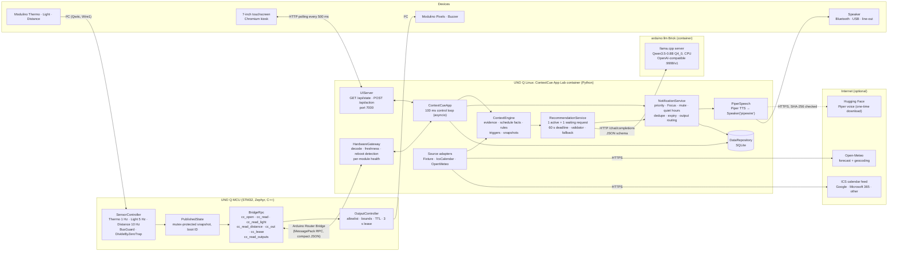
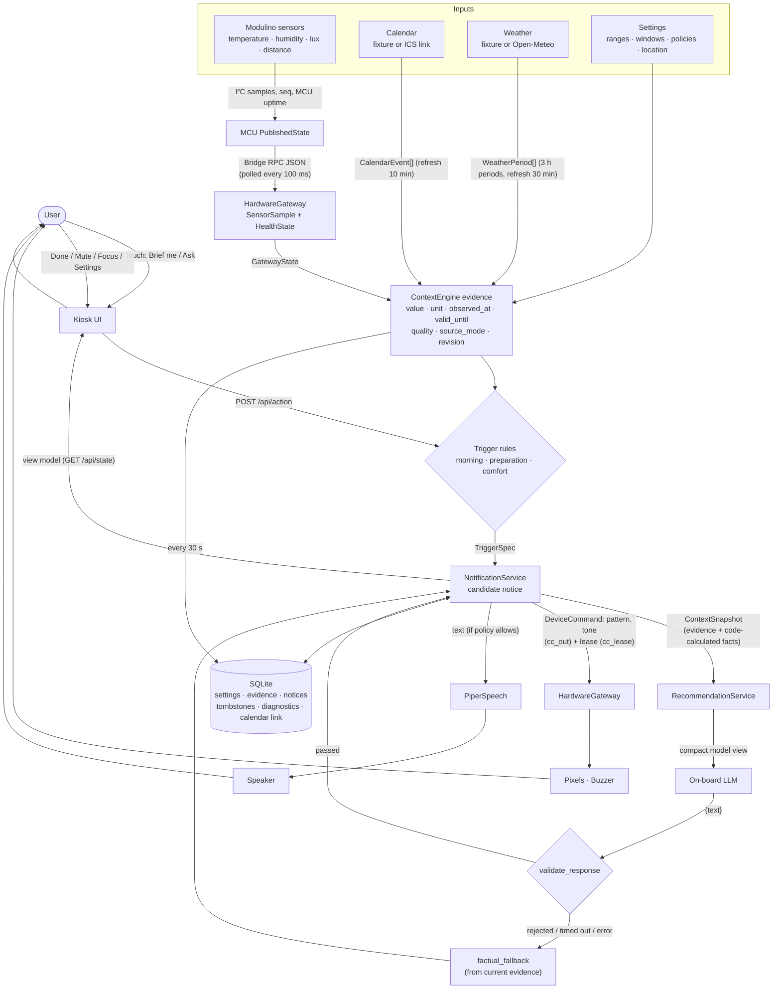

# ContextCue

ContextCue is a desk companion that runs on an Arduino UNO Q. It combines your
calendar, the weather forecast and real indoor sensing into one timely cue,
and it can always show why it gave that cue. It shows cues on a 7-inch
touchscreen and a Modulino Pixels LED strip. It can also play an optional
Buzzer chime and speak the cue with an offline voice. An AI model running on
the board words each cue, and rule-based code decides when a cue is due.

## Problem statement

Busy students and knowledge workers rely on separate calendars, weather apps
and room conditions. Each tool presents a narrow fact, and the user has to
decide which facts matter together and what to do about them. "Design review at
10:00" and "70% chance of rain" are two facts in two apps; "bring an umbrella"
is the cue nobody gives. Static reminders also assume the user is watching the
right screen, and cloud-based assistants stop helping when the network or a
service fails.

(Adapted from
[`ContextCue_Problem_Solution_and_Simulation_Strategy.docx`](docs/background/ContextCue_Problem_Solution_and_Simulation_Strategy.docx),
section 2.)

## What ContextCue does

- Shows the time, the next event, room comfort, the forecast and **at most one
  highest-priority notice** on a 1024x600 touch kiosk UI.
- Raises four kinds of notice:
  - **Morning briefing**, when you approach the desk in the morning window
    (default 06:00–11:00) or tap **Brief me**.
  - **Preparation**, when the next event starts within 30 minutes (urgent
    within 10). It mentions rain at 50% or more, except for online events.
  - **Comfort**, when temperature or humidity stays outside your preferred
    range for 60 seconds. Each condition has a 15-minute cooldown.
  - **Context answer**, for four fixed questions: *What is my next event?*,
    *Will it rain today?*, *How is the room?* and *How busy is today?*
- Words each notice with an on-board LLM (Qwen3.5-0.8B, llama.cpp, CPU only).
  Every reply is validated against the evidence. If a reply is late, invalid
  or unavailable, a labeled factual fallback is shown instead.
- Explains every notice with **Why this?**: each source value, its unit,
  timestamps, freshness, whether it is real or simulated, and whether the text
  came from the AI or the factual fallback.
- Signals state on the Modulino Pixels: one green LED for *ready*, all eight
  amber for *notice*, every other LED red for *fault*.
- Can play an optional Buzzer chime (1760 Hz for 120 ms, off by default) and
  speak notices through the board's sound output (Piper voice via PipeWire).
- Wakes the screen when something comes within 500 mm and dims it after
  2 minutes idle. Screen and LED brightness follow the room's light level.
- Applies Focus, mute, quiet hours (default 22:00–07:00), deduplication,
  acknowledgement and expiry. These rules are deterministic code, not the
  model.
- Uses labeled demo fixtures by default. You can switch to a live calendar
  (an ICS subscription link from Google Calendar, Outlook/Microsoft 365 or any
  other https ICS feed) and a live Open-Meteo forecast for a location you
  choose.

## How it solves the problem

| Problem | How the implementation addresses it |
|---|---|
| Facts are scattered across apps | `ContextEngine` merges calendar, weather, sensor and settings data into one evidence store with per-item quality and freshness ([`engine.py`](services/application/contextcue_app/engine.py)) |
| Nobody connects the facts | Deterministic trigger rules and code-calculated facts (schedule totals, minutes until an event, umbrella and coat advice). The model only words what the code decided ([`engine.py`](services/application/contextcue_app/engine.py), [`schedule.py`](services/application/contextcue_app/schedule.py), [`rules.py`](services/application/contextcue_app/rules.py)) |
| AI text can be wrong | `validate_response` checks the schema, the characters used, and that every number and time appears in the evidence. Rejected or late replies become a labeled factual fallback ([`recommendation.py`](services/application/contextcue_app/recommendation.py)) |
| Reminders go unseen | Several channels: screen, Pixels, optional chime and speech. The screen wakes on approach. Routing follows the audio policy, Focus, mute and quiet hours ([`notifications.py`](services/application/contextcue_app/notifications.py)) |
| Cloud and network failures | The model, voice, sensing, rules and storage all run on the board. Live sources report `stale` or `unavailable` and are never silently replaced with demo data ([`sources.py`](services/application/contextcue_app/sources.py)) |
| Trust | Every notice shows its evidence. Simulated data is labeled at every stage. Missing values stay null and are never invented |

## Main use cases

1. **Morning approach.** You sit down in the morning. The Distance sensor sees
   you, the screen wakes and a briefing names your next event and the weather.
2. **Leaving for a meeting.** An event starts in 22 minutes and the forecast
   says 70% rain. A preparation notice tells you to bring an umbrella, and the
   Pixels turn amber.
3. **Room comfort.** The room stays above 26 °C for a minute. A comfort notice
   suggests opening a window or using a fan.
4. **Quick questions.** Tap **Ask** and choose one of the four questions, or
   tap **Brief me**.
5. **Focus and quiet hours.** Focus holds back the automatic morning
   briefing until you leave Focus and stops automatic speech. Briefings and
   answers you ask for still appear. Quiet hours keep audio silent.
6. **Demo and testing.** Run the app on a laptop with a simulated gateway,
   four fixture scenarios (*Morning briefing*, *Event with rain*, *Warm room*,
   *Quiet hours*), a scenario clock and fault injection.

## Hardware and tools

### Hardware

| Component | Role | Implementation details |
|---|---|---|
| **Arduino UNO Q** | Main board | The Linux side (4x Cortex-A53) runs the Python app, the UI server, the LLM container and speech. The STM32 MCU runs the Zephyr firmware. The two sides talk over Arduino Router Bridge RPC |
| **Modulino Thermo** | Temperature (`degC`) and humidity (`%RH`) | Read at 1 Hz; stale after 5 s. HS300x (`0x44`) or SHT31 (`0x45`), detected by `Arduino_Modulino` |
| **Modulino Light** | Ambient light (`lux`) | Read at 5 Hz; stale after 2 s. Drives screen brightness (20–100%) and Pixels brightness (5–40%). The LTR381 driver's divide-by-zero in darkness is trapped by `DivideByZeroTrap` |
| **Modulino Distance** | Time-of-flight distance (`mm`) | Read at 10 Hz; stale after 2 s. VL53L4CD/VL53L4ED at `0x29`. Near at ≤500 mm, clear above 650 mm, with 500 ms persistence. Nothing in range means "clear"; a failed reading means "unknown" |
| **Modulino Pixels** | Ambient status LEDs (8 RGB) | I²C `0x36`. Allowlisted patterns: `ready`, `notice`, `fault`, `off`. |
| **Modulino Buzzer** | Optional chime | I²C `0x1E`. The MCU enforces 200–5000 Hz and at most 250 ms; the app sends 1760 Hz for 120 ms. Off by default |
| **Waveshare 7" touchscreen** | Display and touch input | 1024x600 on DP-1, USB touch (`0eef:0005`), connected through a USB-C multiport dock. It has no Linux backlight control, so dimming is a CSS overlay |
| **Speaker** | Spoken notices | Any PipeWire output: Bluetooth (A2DP), USB or the board's line-out |
| **USB-C dock and mains charger** | Video, USB and power | Powering the dock from a laptop USB-C port reset the board under full LLM load; a mains charger fixed it ([`services/ai/README.md`](services/ai/README.md)) |

All Modulinos share the Qwiic connector on the MCU's `Wire1` bus. The sensors
report measurements only. Nothing infers identity, occupancy, sleep,
attention or emotion.

Board measurements are in
[`services/peripherals/README.md`](services/peripherals/README.md). The
assembly is drawn in
[`docs/presentation/hardware-assembly.png`](docs/presentation/hardware-assembly.png).

### Software tools

| Tool | Used for |
|---|---|
| **Arduino App Lab / `arduino-app-cli`** | Builds and flashes the sketch, runs the Python app and Bricks in containers ([`scripts/contextcue-app.sh`](scripts/contextcue-app.sh)) |
| **`arduino-cli`** | Compiles the firmware locally with the pinned `unoq` profile (VS Code task) |
| **SSH** | Deploys from a laptop and opens a UI tunnel on port 7300 ([`scripts/unoq.sh`](scripts/unoq.sh)) |
| **Chromium (kiosk mode)** | Shows the UI full screen on the board, with an optional desktop autostart entry |
| **OpenOCD over SWD** | Diagnosed the MCU halt caused by the Light driver ([`DivideByZeroTrap.h`](apps/contextcue-hardware/sketch/src/sensors/DivideByZeroTrap.h)) |
| **VS Code tasks** | Run the tests, compile the firmware, deploy, view logs and stop the app ([`.vscode/tasks.json`](.vscode/tasks.json)) |

## System architecture



The same `ContextCueApp` can run with a `SimulatedGateway` instead of the real
gateway (`--simulated`). It has the same interface and labels every sample
`simulated`; the real app never falls back to it.

### Components

| Component | Location | Responsibility |
|---|---|---|
| **SensorController** | [`sketch/src/sensors/`](apps/contextcue-hardware/sketch/src/sensors/) | Reads and validates the Modulino sensors, assigns sequence numbers, and reports failures as null values with named errors. `BusGuard`/`QwiicBus` stop one stuck I²C device from freezing the MCU |
| **OutputController** | [`sketch/src/outputs/`](apps/contextcue-hardware/sketch/src/outputs/) | Validates and queues Pixels/Buzzer commands. Enforces the allowlist, bounds, TTL, session, duplicate IDs and the 3 s output lease, and turns outputs off when the lease lapses |
| **BridgeRpc / PublishedState** | [`sketch/src/rpc/`](apps/contextcue-hardware/sketch/src/rpc/), [`sketch/src/state/`](apps/contextcue-hardware/sketch/src/state/) | `Bridge.provide_safe` handlers that serve a mutex-protected copy of the readings (responses of 224 bytes at most) |
| **HardwareGateway** | [`contextcue_hardware/gateway.py`](apps/contextcue-hardware/python/contextcue_hardware/gateway.py) | Runs bounded RPCs in worker threads, decodes strictly, maps MCU age to UTC timestamps, detects MCU reboots, and keeps Bridge, sensor and output health separate |
| **Contracts** | [`contextcue_contracts/`](apps/contextcue-hardware/python/contextcue_contracts/) | Shared types (`SensorSample`, `GatewayState`, `HealthState`, `DeviceCommand`, `CommandResult`) and freshness limits |
| **ContextCueApp** | [`app.py`](services/application/contextcue_app/app.py) | Wires the services together, runs the control loop, the output-lease heartbeat and data retention, and exposes the view model and UI actions |
| **ContextEngine** | [`engine.py`](services/application/contextcue_app/engine.py) | Evidence store with revisions, freshness, schedule facts, comfort and proximity rules, triggers, advice and immutable snapshots |
| **RecommendationService** | [`recommendation.py`](services/application/contextcue_app/recommendation.py) | Bounded async queue, `LlamaCppModel` client, response validation and the factual fallback |
| **NotificationService** | [`notifications.py`](services/application/contextcue_app/notifications.py) | Notice lifecycle (candidate → generating → active → acknowledged/expired), priority, policies, and routing to the screen, Pixels, Buzzer and speech |
| **DataRepository** | [`repository.py`](services/application/contextcue_app/repository.py) | SQLite storage for settings, evidence, notices, acknowledgement tombstones, diagnostics and secrets. Keeps 7 days of data and redacts secret-like keys in diagnostics |
| **Source adapters** | [`sources.py`](services/application/contextcue_app/sources.py), [`calendar_ics.py`](services/application/contextcue_app/calendar_ics.py), [`weather.py`](services/application/contextcue_app/weather.py) | Fixture, ICS calendar and Open-Meteo adapters behind one `SourceAdapter` contract. Network fetches run in background threads |
| **PiperSpeech** | [`speech.py`](services/application/contextcue_app/speech.py) | Downloads and checks the pinned voice, then synthesises and plays speech in worker threads. Stop takes effect within about 0.1 s |
| **Sun** | [`sun.py`](services/application/contextcue_app/sun.py) | Offline sunrise and sunset calculation for the UI's sky |
| **UIServer and assets** | [`services/ui/`](services/ui/) | Standard-library HTTP server; plain HTML/CSS/JS with no build step and no network resources |

The class-level design is in
[`docs/architecture/ContextCue_Class_Diagram.mmd`](docs/architecture/ContextCue_Class_Diagram.mmd)
and
[`ContextCue_UML_Class_Reference.md`](docs/architecture/ContextCue_UML_Class_Reference.md).

## Data flow



Notes on the flow:

- **Freshness comes from the source's own timestamps.** Polling a sample
  again does not refresh its age. A new MCU boot ID invalidates the old
  samples. Restored evidence is never treated as fresh.
- **The model sees a compact view only.** The validator checks the reply
  against the full snapshot. A reply that cites evidence which changed in
  the meantime is rejected as obsolete.
- **Secrets stay on the Linux side.** The calendar link is stored as a secret.
  It is never returned to the UI or logged; only its host is shown. The MCU
  receives no account or calendar data.
- **Late results cannot revive notices.** Generation and playback callbacks
  recheck the notice lifecycle, so an acknowledged or expired notice stays
  ended.

## Technologies

**Platforms and runtimes**
- Arduino UNO Q: Linux processor and STM32 MCU
- Arduino Zephyr core `arduino:zephyr` 1.0.0 (FQBN `arduino:zephyr:unoq`)
- Arduino App Lab and `arduino-app-cli`: app containers and Bricks
- Python ≥ 3.10 (`asyncio`, `sqlite3`, `http.server`, `urllib`, `zoneinfo`)
- Debian XFCE desktop on the board, with Chromium in kiosk mode, PipeWire and
  BlueZ ([peripherals notes](services/peripherals/README.md))

**Firmware libraries** (pinned in [`sketch.yaml`](apps/contextcue-hardware/sketch/sketch.yaml))
- `Arduino_RouterBridge` 0.4.4, `Arduino_RPClite` 0.3.1, `MsgPack` 0.4.2
- `Arduino_Modulino` 0.10.0 and its drivers: `Arduino_HS300x`, `SHT31`,
  `Arduino_LTR381RGB`, `STM32duino VL53L4CD`/`VL53L4ED` and others listed in
  the profile

**Python packages** (pinned in [`apps/contextcue/python/requirements.txt`](apps/contextcue/python/requirements.txt))
- `arduino-router-bridge` 0.5.1: Bridge client
- `icalendar` 7.3.0 and `recurring-ical-events` 3.8.2: ICS parsing and
  recurrence expansion
- `piper-tts` 1.8.0 and `onnxruntime` 1.31.1: offline text to speech
- `arduino.app_peripherals.speaker`, provided by the App Lab runtime:
  PipeWire audio output

**AI**
- `arduino:llm` Brick: llama.cpp server with **Qwen3.5-0.8B Q4_0**, CPU only,
  4096-token context, one slot, prompt cache off
  ([`apps/contextcue/app.yaml`](apps/contextcue/app.yaml))
- OpenAI-compatible Chat Completions API with `response_format: json_schema`
  and greedy decoding
- Piper voice `en_US-lessac-medium` (ONNX), from `rhasspy/piper-voices`
  v1.0.0 and pinned by SHA-256

**External APIs** (optional, Linux side only)
- Open-Meteo Forecast API and Geocoding API. No key needed; the UI shows the
  attribution "Weather data by Open-Meteo.com"
- iCalendar (RFC 5545) subscription feeds over HTTPS (`webcal://` is accepted)

**Protocols and formats**
- I²C over Qwiic (`Wire1`)
- Arduino Router Bridge RPC (MessagePack) carrying compact JSON
- HTTP/JSON between the kiosk and the app; HTTP to the LLM server; HTTPS to
  the external APIs
- Unix socket `unix:///var/run/arduino-router.sock` (Router)
- JSON Lines (hardware console output and benchmark output)

**UI**
- Plain HTML, CSS and JavaScript with no framework and no build step
- Lucide icons (ISC) and the Inter font (OFL), both bundled locally

**Testing and tooling**
- `unittest` (215 tests), `g++` for host-compiled firmware tests with
  Arduino/Zephyr stubs, `node --test` for UI logic (optional)
- `arduino-cli`, Bash deploy scripts, VS Code tasks, OpenOCD

## Repository map

Folders under `apps/` follow Arduino App Lab conventions and are named in
kebab-case after their `app.yaml` name. `contextcue-hardware` and
`llm-benchmark` are self-contained and can be copied straight into App Lab.
`contextcue` is a template: App Lab mounts only an app's own folder, so
`scripts/contextcue-app.sh` assembles it with the code it needs from
`services/` and `contextcue-hardware`.

```text
apps/
  contextcue/            Full app template (application + UI + sensors + LLM Brick)
  contextcue-hardware/   Sensing app: HardwareGateway (Linux) + firmware (MCU)
    python/              contextcue_hardware, contextcue_contracts, console entry point
    sketch/              Firmware: sensors/, outputs/, rpc/, state/, Config.h
  llm-benchmark/         G1 on-board LLM benchmark
services/
  application/           ContextCueApp, ContextEngine, RecommendationService,
                         NotificationService, DataRepository, adapters, speech, fixtures
  ui/                    Kiosk UI server, assets and entry point (main.py)
  ai/                    AI notes and measured results (code is in application/)
  peripherals/           Board display, touch and audio findings (no code)
  simulator/             Simulator notes (simulation lives in application/: SimulatedGateway,
                         fixtures, ScenarioClock)
scripts/                 contextcue-app.sh (build/run on the board), unoq.sh (deploy over SSH),
                         ai-eval.py (prompt evaluation)
experiments/             gpu/ (E1: GPU acceleration, failed), thinking/ (Qwen thinking mode)
tests/                   application/, hardware/ (gateway + host-compiled firmware), ui/, llm_benchmark/
docs/                    requirements/, architecture/, planning/, background/, presentation/
```

## Running it

Python 3.10 or newer. The core app and the tests use only the standard
library. Live calendar parsing and speech need the packages in
[`apps/contextcue/python/requirements.txt`](apps/contextcue/python/requirements.txt).

### Laptop (simulated sensors)

```bash
python3 -m unittest discover -s tests -v
python3 services/ui/main.py --simulated          # http://127.0.0.1:7000
python3 services/ui/main.py --simulated --scenario-clock --scenario event_rain
```

Options: `--scenario morning|event_rain|comfort|quiet_hours`,
`--scenario-clock` (dated demo times and time jumps), `--db PATH` (default
`~/.contextcue/contextcue.db`), `--model-url` / `--model-name` (any
OpenAI-compatible server), `--voice-dir` (enable Piper), `--host`, `--port`.
Without `--model-url`, every notice uses the labeled factual fallback.

### UNO Q (real sensors, LLM and speech)

On the board, from a clone kept outside `~/ArduinoApps`:

```bash
git pull
scripts/contextcue-app.sh run              # build ~/ArduinoApps/contextcue, flash, start
scripts/contextcue-app.sh kiosk            # show the UI full screen on the board display
scripts/contextcue-app.sh autostart on     # start the app and kiosk at every boot
scripts/contextcue-app.sh calendar-link    # paste an ICS link (not echoed)
scripts/contextcue-app.sh logs | stop | status | url
```

From a laptop, deploying the working tree (uncommitted changes included):

```bash
scripts/unoq.sh ui-run            # build, copy, flash, start
scripts/unoq.sh ui-open           # SSH tunnel; open http://localhost:7300
scripts/unoq.sh ui-logs | ui-stop | ui-kiosk
```

`scripts/unoq.sh` needs an SSH host alias (default `unoq`) that logs in with a
key. See [`apps/contextcue/README.md`](apps/contextcue/README.md) for what a
build contains. Only one App Lab app runs at a time.

### Hardware-only app and firmware

```bash
python3 apps/contextcue-hardware/python/main.py --help
arduino-cli compile --profile unoq apps/contextcue-hardware/sketch   # compile only
scripts/unoq.sh run                                                  # deploy the sensing app
```

An optional editable install exposes the `contextcue-hardware` console
command (`python3 -m pip install --no-build-isolation -e .`). On an ordinary
laptop the hardware console reports unavailable hardware; it never fabricates
sensor values. Board setup, the wire protocol and Bridge failure reasons
(`mcu_unresponsive`, `router_unavailable`, `gateway_stopped`) are in the
[hardware bring-up guide](apps/contextcue-hardware/README.md).

## Safety and data rules

- Missing values are null and never fabricated. Zero is distinct from
  unavailable.
- Sensor quality and Bridge health are reported separately. A failed module
  does not hide valid readings from the others.
- Observation timestamps are not refreshed by repeated polling. A new MCU boot
  invalidates the previous boot's samples.
- Simulated data is labeled from the source to the screen. Live sources never
  fall back to fixtures, and there is no cloud model fallback.
- Model output must pass the schema, character, number and time checks, and
  the factual fallback is labeled as such.
- MCU output commands are allowlisted, bounded, expiring and session-scoped.
  The MCU enforces this independently of Linux. If Linux stops renewing the
  3-second lease, Pixels and Buzzer turn off.
- Buzzer tones are never replayed after a reconnect, and a restart does not
  resume old audio.
