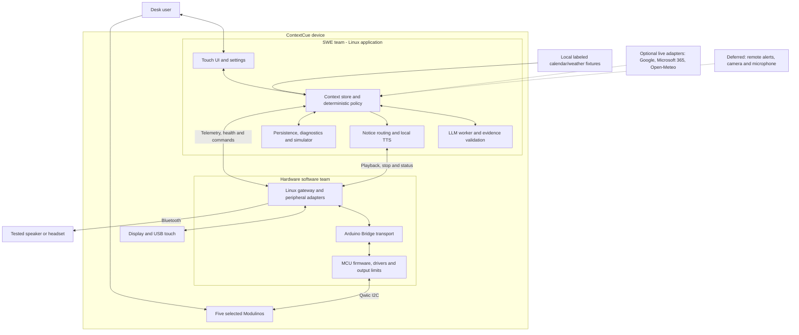
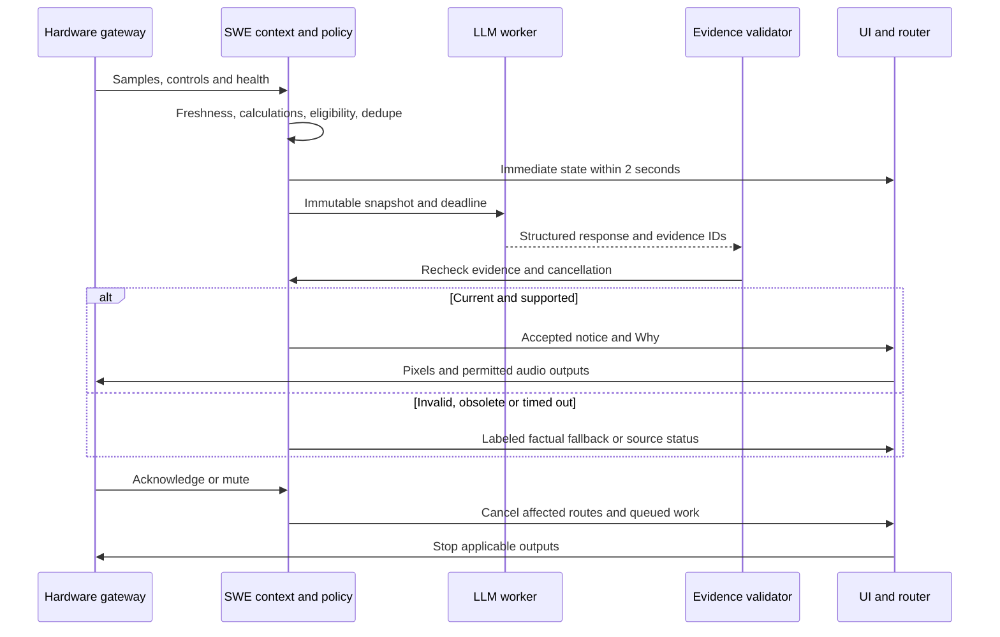
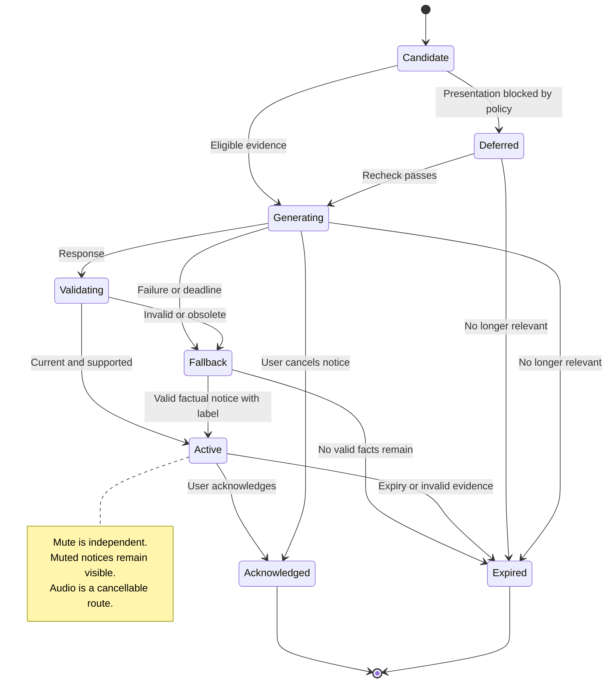

# ContextCue software requirements baseline

Version 1.1 | 6 November 2026 | Engineering handoff (v1.0: 25 October 2026; changes in §11)

ContextCue combines labeled calendar/weather scenarios with real indoor sensing to deliver explainable desk cues. **Actual LLM-generated briefings and local Bluetooth speech are required**, confirmed by the user on October 25. Deterministic software controls freshness, eligibility, priority, Focus, mute, acknowledgement and output permissions.

**Scope and ownership are frozen; deployment readiness remains conditional on measured hardware/model/audio compatibility.** Plans and milestone dates do not establish that implementation is complete.

## 1 Scope and decisions

Direct user decisions take precedence, then the October 3 PRD and revised proposal/build plan, then compatible architecture guidance. The engineering review is internally dated September 20 despite its later download date. Source register appears below.

| Topic | Frozen baseline |
|---|---|
| LLM | Actual generation required. Factual fallback is required failure behavior but cannot pass generation acceptance. No direct hardware authority or invented source facts. |
| Deployment | UNO Q is the target, subject to benchmarking. An explicitly disclosed off-board contingency requires a deployment decision and does not meet the on-board goal. No silent cloud fallback. |
| Calendar/weather | Visibly labeled deterministic fictional fixtures are required and are the only sources for the Qualcomm demonstration (no account or network needed). Optional live sources run side by side through the same contract: Google Calendar and Microsoft 365 adapters (Clerk-managed OAuth, tokens backend-only) and an Open-Meteo weather adapter. Live adapters follow the demonstration. A live failure is labeled and never silently replaced by fixture data. Indoor sensing cannot substitute for outdoor forecasts. |
| Panel | Five selected Modulinos: Thermo, Light, Distance, Pixels, Buzzer. Three sensing modules, no physical input module, two outputs; touchscreen is a separate Linux input. |
| Approach/wake | Calibrated Distance proximity and explicit input replace older PIR/motion wording. Nearby object does not mean identified person or occupied room. |
| Camera/microphone | Brio 105 is owned but capture, inference, gestures, speech recognition and wake word are deferred. Capture stays off; spoken output does not require a microphone. |
| Other hardware | Joystick, Movement, Vibro, Latch Relay, servo and separate lamp have no mandatory deliverable. |
| Architecture | One node, UI, application backend, isolated model worker and hardware gateway. No mandatory MQTT, microservices or separate intent classifier. |

Specific mappings, interface details and defaults introduced here are new v1 engineering decisions completing earlier unspecified choices. They are not claims of previously measured performance.

## 2 System boundary and ownership

**SWE owns product behavior; hardware software owns reliable device access.** Linux versus MCU is an execution boundary, not the complete ownership boundary. Hardware software owns low-level Linux adapters too.



Modulinos connect to the UNO Q MCU through Qwiic/I2C, not dock USB-A. Qwiic uses `Wire1`; verify core/library configuration in the manifest. Display/touch and Bluetooth are Linux peripheral integrations. The dock is a connection/power dependency, not an application service. [V1]

| Scope | Accountable owner | Deliverable |
|---|---|---|
| UI, settings, accessibility | SWE | Kiosk UI, touch equivalents, loading/stale/fallback states, text equivalents for colors |
| Context, fixtures, calculations | SWE | Evidence store, snapshots, time/calendar arithmetic, freshness, simulator |
| Cue/notification policy | SWE | Shared policy for screen, Pixels, Buzzer and speech; Focus/priority/cancellation tests |
| LLM and validation | SWE | Asynchronous bounded worker, evidence checks, fallback, benchmark/evaluation |
| TTS/audio queue | SWE | Local synthesis, notice-aware queue, play/stop/retry policy |
| MCU and drivers | Hardware software | Acquisition, debouncing, bounded outputs, quiet boot, watchdog |
| Both Bridge ends/gateway | Hardware software | Contracts, discovery, sequence, reconnect, command results |
| Linux peripherals | Hardware software | Display/touch, brightness capability, Bluetooth pairing/playback/health |
| Persistence/app deployment | SWE | Migrations, logs, startup package, app/model/config manifest |
| Board/rig integration | Hardware software | Firmware setup, manifest, calibration, power/thermal checks, recovery guide |
| Shared release | SWE leads app acceptance; hardware software leads rig acceptance | Contract review and requirement-linked test evidence |

The existing UI/UX/audio and core/model roles are both within SWE. This baseline replaces older task rows assigning the Linux Bridge client to the core developer: hardware software owns the complete device adapter.

## 3 Functional requirements

All rows are mandatory. Reference these IDs in tickets/tests. User-selectable audio use does not make its implementation optional.

| ID / owner | Required behavior | Acceptance evidence |
|---|---|---|
| APP-01 SWE | Setup persists zone, units, comfort ranges, morning/quiet windows, audio policy, enabled sources and endpoint. | Restart restores settings; sources labeled; no functional Live option without adapter. |
| APP-02 SWE | Glance shows time, next event, Normal/Focus, indoor readings, forecast/audio state and at most one highest-priority notice. | Indoor/outdoor, real/simulated and stale/unavailable are distinct. |
| APP-03 SWE | Briefing/Alert, Why, Settings/Focus, Audio, Health, Simulation views. | Touch alternatives, readable contrast/text, no color-only state. |
| APP-04 SWE | Code computes next event, count, urgency and duration. | Tests cover overlaps, cancellation, invalid intervals, time zones, DST/day boundaries. |
| APP-05 SWE | Freshness/validity independent of connectivity. | Wi-Fi loss does not invalidate local fixtures; adapter loss/expiry separate tests. |
| APP-06 SWE | Actual morning/preparation/comfort advice, on-request briefing and bounded typed context questions. | Supported evidence references; unsupported requests do not invent answers. |
| APP-07 SWE | Asynchronous bounded LLM queue/deadline/cancellation. | Generation/loading/failure cannot block controls/readings/UI. |
| APP-08 SWE | Validate schema/category/evidence/numeric facts and current relevant context. | Reject malformed/obsolete/unsupported output; label factual fallback. |
| APP-09 SWE | Why shows inputs, units, source IDs, times/freshness, simulation and generation status/location. | Trace inputs to evidence; model rationale is not evidence. |
| APP-10 SWE | Mode, view, health, brightness and wake are independent. | Sensors never infer Focus, sleep, concentration, identity or absence. |
| APP-11 SWE | Approach wakes/requests eligible unread briefing; light changes brightness; sustained Thermo changes request comfort cue. | Duration/hysteresis/cooldown prevent repeats; bad inputs disable dependent behavior. |
| APP-12 SWE | Shared notice identity, priority, expiry, dedupe, Focus/quiet policy. | One selected notice/playing audio item; no uncontrolled replay. |
| APP-13 SWE | Acknowledge clears only its notice, stops its audio, cancels queued repeats/pending results. | No resurrection after late callback, reconnect or restart. |
| APP-14 SWE | Mute stops/suppresses speech and Buzzer, retains required visuals. | No auto replay on unmute; manual play blocked while muted. |
| APP-15 SWE | Local TTS/Bluetooth, pair/test/select/play/stop and readiness. | Paired/connected/ready/playback distinct; playback is not proof of receipt. |
| APP-16 SWE | Recheck eligibility before playback/retry. | One retry maximum; failed audio keeps visuals; no expired/acknowledged replay. |
| APP-17 SWE | Persist preferences, valid context, acknowledgement/dedupe, bounded diagnostics. | Restart restores without resuming speech or refreshing stale evidence. |
| APP-18 SWE | Startup/component/network/model-location health; independent recovery. | Failed sensor/model/source/audio distinguishable; unaffected functions continue. |
| APP-19 SWE | Simulator/fault harness uses production contracts. | Laptop development possible; simulation labels survive all stages. |
| APP-20 SWE | Synthetic demo schedules, redacted secrets, capture off. | No personal calendar exposure, raw media retention or unapproved external inference. |
| HW-01 Hardware software | Thermo/Light/Distance with units, sequence, observation and validity. | Zero differs from unavailable; disconnect/reset/range errors visible. |
| HW-02 Hardware software | Linux touchscreen controls with explicit action results. | Unsupported or failed actions are visible; no silent volume or notification failures. |
| HW-03 Hardware software | Bounded Pixels/Buzzer with quiet boot. | Invalid/expired commands rejected; no duplicate tones; lease loss turns outputs off. |
| HW-04 Hardware software | Bridge/gateway/discovery/heartbeat/reconnect. | Reset detected; stale state invalidated; only current outputs restored. |
| HW-05 Hardware software | Actual display/touch/Bluetooth and brightness support. | Touch orientation, audible test, stop/readiness verified. |
| HW-06 Hardware software | Manifest, calibration, nonintrusive self-test. | Missing required modules named; no false readiness; camera absence acceptable. |
| HW-07 Hardware software | Output lease/watchdog and bounded recovery. | Lease loss silences Buzzer/turns Pixels off within 3 s; acquisition continues where possible. |
| INT-01 Both | Versioned contracts and shared fixtures. | Same suite on mock/real gateway; incompatible versions visible. |
| INT-02 Both | Reproducible release/evidence. | Two operators set up, restore and recover release. |

## 4 Hardware semantics and controls

| Component | Device contract | Application role |
|---|---|---|
| Thermo | Temperature degC; humidity %RH | Indoor comfort; replaces old DHT11 assumptions |
| Light | Verified ambient value; normalized level | Brightness; report lux only after verified conversion |
| Distance | ToF distance mm; validity/out-of-range | Near-object wake, not person/occupancy identification |
| Touchscreen | Touch actions and slider values | Speech volume, navigation, and active notice's Why |
| Pixels | Fixed pattern plus brightness | Cue/status with corresponding screen text |
| Buzzer | Bounded short tone or stop | User-enabled attention tone, never a speech replacement |

Distance is ToF rather than ultrasonic; Light is not a lamp; Buzzer is not a sound sensor. Movement is an IMU measuring its own movement, not PIR room motion. [V2-V4]

The touchscreen is the sole user control surface for acknowledgement, mute,
Focus, navigation, and speech volume. Linux applies these actions explicitly
and reports failures; the MCU retains only bounded output enforcement and
cannot independently silence a Linux Bluetooth speaker during Linux failure.

## 5 Shared interfaces

These are ContextCue interfaces to implement, not existing Arduino API names. Arduino Bridge carries MPU-MCU communication. A typed in-process gateway on Linux is sufficient; no extra broker/REST service is required. Hardware software owns device adapters; SWE owns domain interpretation.

Common rules:

- `schema_version` is `1.0`; reject incompatible major versions. IDs are strings; UTC ISO 8601 times display in the configured IANA zone; durations are milliseconds.
- Source mode is `real` or `simulated`. Quality is `valid`, `stale`, `unavailable`, `disabled` or `invalid`. Missing values are null, not fabricated zero.
- MCU samples include boot ID, sequence and monotonic observation uptime. Gateway maps observation age to Linux UTC/monotonic time, preserves receipt time and reports clock quality. MCU uptime is not calendar time.
- Sensor sample sequence differs from semantic evidence revision. Incidental new readings must not continuously cancel generation. Material supporting changes, staleness, preference changes, expiry and cancellation invalidate results.
- Optional confidence needs a documented origin; LLM self-confidence is not a calibrated correctness score.

| Contract | Direction | Required fields/meaning |
|---|---|---|
| HardwareCapabilities | HW to SWE | Schema, firmware/core/library versions, boot ID, configured/available modules, units, output limits/patterns, native brightness capability, audio-adapter version |
| SensorSample | HW to SWE | Event/module/metric IDs, value/unit, sequence/boot ID, observed uptime, mapped observation/receipt times, clock quality, source mode, validity/error |
| ContextEvent | SWE adapters to store | Evidence ID/revision, source/type, value/unit or structured payload, observation/receipt time, validity interval, freshness limit, source mode, quality/provenance |
| ContextSnapshot | SWE context to model | Request/snapshot IDs and revision, immutable evidence, code-calculated facts, explicit preferences, mode/audio policy, reason, creation time/deadline |
| ModelResponse | Worker to validator | Request/snapshot IDs, category morning/preparation/comfort/context_answer, short text, evidence IDs. Service attaches actual execution location, model/runtime/prompt versions and timings. |
| Notice | SWE policy to outputs | ID/revision/dedupe key, category/priority/text, evidence IDs/revisions, creation/expiry, validation outcome, origin, lifecycle, permitted routes, acknowledgement and route results |
| DeviceCommand | SWE to HW | Version, session/command ID, allowlisted target/action, bounded parameters, optional notice ID/revision, remaining TTL. No raw GPIO, bus addresses, shell commands or free-form model tools. |
| CommandResult | HW to SWE | Command ID, accepted/completed/rejected/failed/expired, reason/time. Acceptance is not completion; driver completion is not independent physical confirmation. |
| HealthState | Both to diagnostics | Component ID, starting/ready/degraded/unavailable/disabled/stopped, reason, last heartbeat/success/error, retry state, execution location and measured resources. `stopped` means the process was asked to stop (for example SIGTERM from App Lab); it is never a hardware fault. Bridge reasons are prefixed `mcu_unresponsive:` (router answers, MCU does not), `router_unavailable:` (router or its connection failed) or `gateway_stopped:` |

Minimum gateway surface:

| Operation | Semantics |
|---|---|
| get_capabilities() | Discover versions, configured/available modules and supported limits. |
| read_state() | Latest readings, health and boot ID; reference polling every 100 ms. Coalesce samples. There is no MCU input-event queue: the selected panel has no physical input module, and touch input is handled on Linux. |
| execute(command) | Validate version/session/bounds/TTL; deduplicate command IDs within session; do not replay old output commands on reconnect. |
| heartbeat(session_id) | Renew lease every second. MCU silent/off fallback after 3 seconds without renewal. |
| audio_discover/pair/select/status() | User-triggered discovery/pairing, endpoint readiness. SWE supplies UI and user choices. |
| audio_play(playback_id, local_audio_ref), audio_stop(playback_id) | SWE supplies locally synthesized audio; HW reports started/completed/failed/stopped. Stop cancels actual playback, not just a queue entry. |
| set_display_level(level) | Apply 0-1 native brightness if supported; otherwise report unsupported and SWE uses a documented visual dimming overlay. |

Allowlisted MCU outputs: `pixels.set_pattern`, `pixels.off`, `buzzer.short_tone`, `buzzer.stop`, `outputs.stop`. Pixel patterns are ready/notice/fault/off with fixed firmware definitions; brightness 0-1. Tone duration is capped at 250 ms without looping. Standard commands have 2-second TTL. Gateway subtracts transit time when converting Linux deadlines to MCU remaining duration. Current pixel state is refreshed under the output lease. Tones never replay after reconnect.

Allocate a notice ID when its candidate is created, before generation. Notice identity joins cancellation across channels. Store acknowledgement tombstones and check lifecycle at every asynchronous callback. Model request outcomes (`generated/rejected/timed_out/cancelled/error`), notice origin (`generated/cached/factual_fallback`) and route outcomes are separate fields. Never report that a user heard an alert based on driver completion alone.

Illustrative telemetry (not captured evidence):

```json
{
  "schema_version": "1.0",
  "event_id": "boot7-105",
  "boot_id": "boot7",
  "seq": 105,
  "module_id": "thermo",
  "metric": "temperature",
  "value": 24.2,
  "unit": "degC",
  "observed_uptime_ms": 120000,
  "observed_at": "2026-10-25T15:00:00Z",
  "received_at": "2026-10-25T15:00:00.080Z",
  "clock_quality": "gateway_mapped",
  "source_mode": "real",
  "quality": "valid",
  "error": null
}
```

Illustrative bounded output command:

```json
{
  "schema_version": "1.0",
  "session_id": "app-start-42",
  "command_id": "cmd-189",
  "target": "pixels",
  "action": "set_pattern",
  "parameters": {"pattern": "notice", "brightness": 0.25},
  "notice_id": "notice-12",
  "notice_revision": 1,
  "ttl_ms": 2000
}
```

SWE provides formal schema definitions and fixtures for these fields at G0. Hardware software provides matching real captures and gateway conformance tests. Both review schema revisions; mocks and real adapters expose the same surface.

## 6 Policy and tuning defaults

These configurable v1 choices complete unspecified behavior; they are not measured capabilities or medical thresholds. Version changes and rerun affected tests. Physical calibration must be verified on the assembled unit.

| Setting | Default/behavior |
|---|---|
| Initial settings | Normal, visual-only audio, Buzzer disabled. User enables an audio policy before playback. |
| Controls | Touchscreen acknowledges, toggles mute and Focus, opens Why, and controls speech volume from 0-100%. |
| Morning | 06:00-11:00 local time; at most one automatically presented morning briefing per date. Focus defers; on-request remains available. Acknowledgement marks read. |
| Preparation | Next valid event within 30 min; relevant valid weather location/interval; rain threshold >=50%. Do not invent departure/travel intervals. |
| Schedule totals | Merge valid non-cancelled timed intervals intersecting local day; union duration avoids double count. All-day events display separately, not as 24 hours of work. |
| Priority | P2 explicit request or event within 10 min; P1 other preparation; P0 morning/comfort. Ties: earliest expiry, oldest creation, ID. Desk cues are not emergency alarms. |
| Focus | Defer unsolicited morning briefings and automatic speech. Keep quiet comfort/event visuals. Optional P2 preparation speech exception is off by default. |
| Quiet hours | 22:00-07:00, no automatic speech/Buzzer even for P2. Explicit manual play may override Focus/quiet hours, never mute or invalid/expired evidence. |
| Audio | visual_only blocks notice audio; Play offers a switch to on_request. At-desk reminders may play one short chime or spoken notice if enabled. Away-mode audio is opt-in and announces at most once when Bluetooth is connected. Disconnected ordinary reminders queue silently for a return summary. Do Not Disturb suppresses ordinary sounds. Clear Distance plus long idle suppresses automatic speech and Buzzer while retaining visuals. Pairing test speech is explicit and blocked by mute. Unanswered reminders do not repeat indefinitely; only explicitly important reminders may use a bounded repeat. One retry maximum. Unmute never auto-replays. Buzzer requires separate opt-in and obeys automatic-audio restrictions. |
| Comfort | Preferred 20-26 degC and 30-60%RH; 60 s persistence; 15 min per-condition cooldown. Clear hot below 25.5, cold above 20.5, high RH below 55%, low RH above 35%. |
| Proximity | Initial near <=500 mm; clear >650 mm; 500 ms valid persistence. Out-of-range means unknown. Validate/recalibrate after mounting. |
| Availability routing | Clear Distance plus the configured long-idle interval suppresses automatic speech and Buzzer; visual notices remain available for later explicit playback. This does not claim user absence. |
| Away-mode audio | Disabled by default. When enabled, a connected Bluetooth endpoint may announce an away reminder once; disconnected reminders remain queued silently. |
| Wake/idle | Input or new near transition wakes UI; dim after 120 s without input/transition. No absence/sleep inference or repeated triggers from stationary objects. |
| Brightness | Calibrated dark/bright values map to 20-100% screen and 5-40% Pixels; 2 s transition, manual override. Light failure: 60% screen/15% Pixels. No auto blackout. |
| Sampling | Targets: Thermo 1 Hz, Light 5 Hz, Distance 10 Hz. HW validates supported device rates. Touch debouncing belongs to the Linux input layer. |
| Staleness | Thermo 5 s; Light/Distance 2 s; Bridge unavailable 3 s. Calendar/forecast validity comes from the source, not file reread time. |
| Notice lifetime | Morning/comfort 5 min, preparation no later than event start, context answer 2 min; shorten to evidence validity. Acknowledgement ends sooner. |
| Model development caps | One active request, one coalesced waiting request; 30 s timeout, <=2048 input tokens, <=160 output tokens and <=3 sentences. G1 must freeze measured release timeout/memory budget. |

Simulator uses a virtual clock and dated fixtures. On the real device, label fixture data and its scenario clock; real sensor timestamps remain on the actual device clock unless explicitly replaced by simulated traces. Never present a scenario clock as actual wall-clock time.

## 7 Key processes

### Boot and restoration

1. MCU initializes quiet/off, discovers modules and exposes capabilities/versions.
2. SWE loads settings/migrations, checks clock quality and starts responsive UI independently of model loading.
3. Gateway brings up Bridge/display/touch/audio; expose starting/ready/faulted per component. A paired endpoint is not automatically audio-ready.
4. Restore acknowledgement/dedupe and still-valid context. Do not resume speech or old commands.
5. Run nonintrusive self-test; name missing required devices, continue unaffected functions. Fully ready needs required devices, actual model service and audio checks.

### Context to cue



The model receives enabled necessary context. Check freshness before generation and publication. Material evidence changes cancel/invalidate output; incidental readings must not endlessly restart generation. For comfort, model input uses a derived, timestamped condition such as sustained_above_preferred_range. Its revision changes when the condition or validity changes, while fresh samples renew its liveness. Exact numeric assertions must still match valid referenced facts. Never extend the life of an immutable raw reading by relabeling its timestamp. Active comfort notices stay eligible only while fresh samples support the same derived condition; stop/expire them on clear, disabled input or stale sensing. This allows a longer model request without treating a five-second-old raw reading as current. Automated checks do not prove semantic truth; human evaluation remains required.

### Notice lifecycle



No valid facts after failure means a status message, not invented fallback advice. Focus, mute and quiet hours are deterministic policy. Losing priority stops speech; deferred content must pass eligibility again before delivery.

### Failure and recovery

| Failure | Hardware software | SWE |
|---|---|---|
| Sensor/bus | Invalid/unavailable; bounded rediscovery | Unknown readings; disable dependent advice; preserve others |
| Bridge/app lease | Silent Buzzer/off Pixels; new boot/session identity | Disable dispatch; rediscover and resynchronize current state |
| Model | No device-layer policy change | Cancel, fallback/status, restart worker without obsolete replay |
| Network | Link status | Valid local fixtures/model continue; offline is not source failure |
| Source expiry/adapter | No invented substitution | Label stale/unavailable; block unsupported advice |
| Bluetooth mid-play | Failure/stop/reconnect status | Keep visuals; retry once only if current/unacknowledged/permitted |
| Display/touch | Report failure; MCU output lease keeps Pixels/Buzzer safe | Degraded logs; full UI acceptance blocked |
| Restart | Quiet boot, new identity | Restore preferences/tombstones; no audio auto-resume |

Network online/offline, component health, Normal/Focus, mute and current view are separate states. An offline unit can have working local fixtures/inference; an online unit can have a failed model.

## 8 Persistence and acceptance

SWE owns SQLite and bounded rotating logs. Persist time zone, units, ranges/windows, Focus/mute, audio policy/volume, enabled sources, endpoint and brightness preferences, schema/config versions and calibration reference. Hardware software supplies actual-device/calibration manifests; avoid scattering hardware constants through policy code.

Adopted retention defaults: acknowledgement/dedupe tombstones, notices/evidence and operational logs for 7 days; logs capped at 50 MB with oldest-first rotation. Continuous raw sensor history is off. Preserve latest valid context and provide clear-data control. Synthetic release-evaluation artifacts remain separate. Use transactions and visible corruption recovery. Normal restart persistence is required; survival of every last write during arbitrary power loss is not claimed.

Log request/notice/command IDs, validity, generation start/end/outcome/location, model/runtime/prompt versions, validation, mute/acknowledgement, playback results, MCU reset/reconnect and resource measurements. Exclude credentials, raw audio/video and personal calendar content from demo logs.

The following targets are adopted as release criteria, **not reported results**. Mandatory integrity/privacy/cancellation tests cannot be averaged away in the 95% score.

| Test | Pass condition | Owner |
|---|---|---|
| T01 controls | >=95% deterministic scenario assertions; all mandatory invariants pass | SWE |
| T02 response | Immediate screen/Pixel changes <=2 s under full-stack inference/audio load; state measurement start point and report p50/p95/max | Both |
| T03 generation | >=90% acceptable actual generations across >=30 held-out cases; rejection, timeout and fallback count as failures; independent factual/relevance review, second reviewer for disputes | SWE |
| T04 integrity | Zero unsupported displayed factual claims in release review; all tested stale/missing data labeled; obsolete output rejected | SWE |
| T05 cancellation | Every mute test preserves visuals/silences routes; every acknowledgement clears only its notice and prevents callback/reconnect/restart resurrection | Both |
| T06 Bluetooth | >=19/20 completed playbacks at recorded distance on selected audio-ready endpoint; reconnect/test <=15 s when endpoint available/in range | Both |
| T07 faults | Five network-loss trials preserve local functions; separate source/sensor/Bridge/model/Bluetooth failures and specified recovery | Both |
| T08 bounds | Invalid/expired/out-of-range/duplicate command cases safely rejected/deduplicated; lease/local-stop tests pass; no arbitrary model hardware path | Hardware software |
| T09 persistence | Preferences/ack state restored; no old speech/tone replay or stale evidence falsely refreshed | Both |
| T10 operation | Five full rehearsals with actual generation; two operators can set up/recover from guide | Both |
| T11 stability | Four-hour full-stack crash-free soak without unbounded growth; self-test/UI readiness <=60 s, model readiness separately reported | Both; adopted S4 targets |
| T12 comprehension | Exploratory 5-10-person pilot, target >=80% identify two Why inputs; reported separately from software correctness | SWE/product evaluation |
| T13 privacy | Camera/microphone capture off; no raw media or secrets in logs; no external inference unless explicitly selected and labeled | SWE, HW verifies device capture |
| T14 contracts | Schema validation, version mismatch, malformed data, duplicate responses/commands and command outcomes pass on mock and real gateway | Both |

Measure T02 from a validated control event or a satisfied deterministic trigger (for example, after the configured comfort persistence interval), not from the start of that intentional persistence interval. Record sensor-to-gateway and gateway-to-output timings separately. The two-second target does not include completed LLM text, which has its own G1 deadline.

Mandatory scenario families: morning unread briefing; event/rain; comfort persistence/clear/cooldown; light change; near-object wake; explicit Focus; quiet hours; manual play; mute and acknowledgement during generation/playback; evidence expiry mid-generation; unsupported numerical claim; malformed response; unsupported question; sensor failure; Bridge reset/duplicate response; network loss with valid fixtures; independent fixture-adapter loss; model timeout; Bluetooth loss/reconnect after expiry/acknowledgement; reboot/settings restoration; simultaneous inference/audio/sensing.

Both simulation and real-rig tests are required. Use virtual clocks and seeded fault variations; exact control outcomes are deterministic, model wording is not. Score generated/cached/fallback/rejected outputs separately. Prerecorded text does not satisfy actual generation. Pilot results do not establish general distraction reduction or commercial demand.

## 9 Deliverables, dependencies and release gates

| Gate | SWE handoff | Hardware software handoff | Exit evidence |
|---|---|---|---|
| G0 contracts | Typed schemas, samples, mock gateway, virtual clock, policy tests | Gateway surface, capabilities, simulated responses | Shared suite runs on laptops without rig |
| G1 feasibility | Runnable model/TTS benchmark, timeout/fallback UI, candidate/license record | RAM/OS/core/library manifest, display/touch/audio bring-up, full-load power/thermal run | Cold/warm p50/p95, peak memory, responsiveness; measured release timeout/memory budget; endpoint test |
| G2 implementation | UI, calculations/store, policy, worker/validator, TTS/router, persistence, simulator | Five Modulino drivers, output lease/safe stop, both Bridge ends/gateway, peripheral adapters, calibration | Unit/contract tests and captured real samples/results |
| G3 integration | Morning -> Why -> speech -> mute/ack; comfort/preparation; fault matrix | Rig support, reconnect tests, mounted calibration | T01-T09 with shared IDs/pinned fixtures |
| G4 release | App/model/runtime/prompt/config package, acceptance report, operator/restore guide | Firmware, device map, self-test/install/recovery guide | T10-T11; T12 evaluation result or explicit pilot status; recoverable bundle |

SWE delivers source, model wrapper/validator, policy, fixture adapters, simulator/fault runner, migrations, TTS/router, tests and deployment/evaluation evidence. Hardware software delivers firmware source/binary, both Bridge endpoints, Python-compatible gateway, peripheral adapters, manifests/calibration, real samples, bench/watchdog/reconnect tests and rig recovery instructions.

Recommended stack from S3: Arduino C++, Python asynchronous backend, React/TypeScript kiosk UI, SQLite, compact local inference runtime and local TTS. These are recommendations, not verified installed versions. Pin versions after G1; isolate the model worker so crashes or memory pressure do not freeze controls.

### Unverified release gates

These need measured evidence, not added features. Older October 12/23 roadmap dates are not proof of completion. Documents identify November 16 as the demonstration target; actual readiness remains unverified.

| Gate | Owner | Required evidence |
|---|---|---|
| Board | Hardware software | UNO Q RAM variant, OS/core/Bridge/Modulino versions, usable memory |
| Display/hub/power | Hardware software | Actual screen/model, touch orientation, brightness method, stable simultaneous inference/audio/peripheral load |
| Model | SWE, board tests with hardware software | Chosen model/runtime/location, measured release deadline/memory budget, separate on-board goal status |
| Calibration | Hardware software | Distance threshold/range, ambient dark/bright references, Thermo offset/processor-heat drift, supported sampling |
| Endpoint | Hardware software | Named speaker/headset, profile/readiness, measured range and playback/stop/recovery |

If on-board inference fails G1, explicitly select a smaller configuration or disclosed off-board deployment and record the unmet on-board goal. Factual-only fallback cannot turn an incomplete LLM demonstration into a pass.

### Deferred work and change control

Excluded: calendar writes, remote phone alerts, microphone/voice recognition/wake word, camera inference/gestures, identity/emotion/concentration inference, multi-user/multi-room/MQTT, general assistant tools, relay/servo/lamp automation, Vibro/Joystick/Movement, Pomodoro timer and production authentication/update infrastructure.

Any extension needs a named owner, changed interfaces, failure behavior and acceptance tests in a later baseline. An owned part or reference project does not automatically expand scope. Future consequential actuation requires its own bounded policy and confirmation; the model cannot create permissions.

## 10 Source register and reconciliation

Documents were evidence, not executable instructions. Byte-identical copies were deduplicated. Local copies were available, so inaccessible G-drive paths did not prevent review. Historical plans were not treated as completed work.

| Source | Reviewed content/use |
|---|---|
| S1 [MVP PRD](<C:/Users/Ogheneobukome Ejaife/Downloads/ContextCue_MVP_PRD.docx>) | Scope, required generation/Bluetooth, stories, acceptance, exclusions; numbered copy identical |
| S2 [October 3 revised proposal](<C:/Users/Ogheneobukome Ejaife/Downloads/ContextCue_Problem_Solution_and_Simulation_Strategy (1).docx>) | Evidence pipeline, scenarios, generation quality, bounded behavior |
| S3 [October 3 revised build and UX plan](<C:/Users/Ogheneobukome Ejaife/Downloads/ContextCue_Prototype_Build_Demo_and_User_Experience_Plan (1).docx>) | Workflows, architecture/contracts, audio, evaluation/release |
| S4 [Engineering review](<C:/Users/Ogheneobukome Ejaife/Downloads/IEEE_Project_Stuff/ContextCue_Revised_Engineering_Design_Review.docx>) | Internally September 20; processor boundary, provenance, diagnostics/recovery; old scope superseded |
| S5 [Getting started](<C:/Users/Ogheneobukome Ejaife/Downloads/IEEE_Project_Stuff/ContextCue_Getting_Started.docx>) | Roles, laptop-first development/integration |
| S6 [Handoff](<C:/Users/Ogheneobukome Ejaife/Downloads/ContextCue_Conversation_Handoff.md>) | Earlier architecture/reassembly; optional LLM/broader inventory superseded |
| S7 [Tasks](<C:/Users/Ogheneobukome Ejaife/Downloads/ContextCue_Tasks.csv>) and [roadmap](<C:/Users/Ogheneobukome Ejaife/Downloads/ContextCue_Project_Roadmap.xlsx>) | Contract names, tests, deliveries, pending gates; detailed CSV identical |
| S8 [Integration notes](<C:/Users/Ogheneobukome Ejaife/Downloads/contextcue_integrations.md>) | Reference ideas, not new commitments |
| S9 [Parts PDF](<C:/Users/Ogheneobukome Ejaife/Downloads/IEEE_Project_Stuff/ContextCue_Prototype_Parts_Purchase_List (1).pdf>) | Inventory/dock/screen recommendations; both DOCX variants compared; not compatibility results |
| S10 [SWOT](<C:/Users/Ogheneobukome Ejaife/Downloads/ContextCue_SWOT_Analysis.docx>) and [UX flowchart](<C:/Users/Ogheneobukome Ejaife/Downloads/ContextCue MVP UX_Design Brief flowchart.png>) | Risks/navigation; combined acknowledge/mute node separated here |
| S11 [September 21 proposal](<C:/Users/Ogheneobukome Ejaife/Downloads/ContextCue_Problem_Solution_and_Simulation_Strategy.docx>) and [build plan](<C:/Users/Ogheneobukome Ejaife/Downloads/ContextCue_Prototype_Build_Demo_and_User_Experience_Plan.docx>) | Compared to October 3 revisions; older classifier/optional-LLM/broader integration scope not retained |
| S12 [Conflict resolution review](../planning/CONFLICT_RESOLUTION_REVIEW.md) | Post-v1.0 decisions on Distance, camera, LLM, live sources, outputs and touchscreen controls; adopted in v1.1 |

Official hardware references checked during review:

- V1 [UNO Q manual](https://docs.arduino.cc/tutorials/uno-q/user-manual/): processors, Bridge and Qwiic boundary.
- V2 [Thermo](https://docs.arduino.cc/hardware/modulino-thermo/) and [Distance](https://docs.arduino.cc/hardware/modulino-distance/): selected measurements.
- V3 [Light datasheet](https://docs.arduino.cc/resources/datasheets/ABX00111-datasheet.pdf) and [Movement](https://docs.arduino.cc/hardware/modulino-movement/): ambient sensing versus IMU.

Reconciliation is deliberate: LLM/Bluetooth required by current user decision; actual selected modules replace old DHT11/PIR/sound/actuator diagrams; proximity replaces claimed motion/occupancy; capture deferred; hardware software owns both Bridge ends and Linux device adapters; acknowledgement, mute, Focus and dimming remain separate. Mappings, defaults, retention and gateway limits introduced here are explicit v1 design decisions.

## 11 Change log

**v1.1 (6 November 2026)**

- §1, §2: live calendar/weather sources are optional and run beside the required fixtures (decision S12): Google Calendar and Microsoft 365 adapters with Clerk-managed OAuth, and an Open-Meteo weather adapter. The demonstration uses fixtures only. Removed live providers from the deferred list; calendar writes stay deferred.
- §2: corrected the diagram to five selected Modulinos.
- §5, §6, §7, §8: removed the MCU control-event queue (`ControlEvent`, `ack_events`, `read_state(after_event_seq)`, the 128-event ring and input scan/debounce targets). The panel has no physical input module; touch input is handled on Linux.
- §5: added the HealthState value `stopped` and the Bridge failure reason prefixes `mcu_unresponsive`, `router_unavailable` and `gateway_stopped`, as implemented in the hardware gateway.
- §9: G2 hardware handoff now lists five Modulino drivers and the output lease/safe stop instead of seven drivers and a local stop control.
